# 🎮 派對遊戲 Party Games

一台裝置當主畫面，朋友用手機掃 QR code 就變成搖桿，最多 8 人一起玩。
純網頁、免安裝 App、免架伺服器。目前有兩個遊戲：

- **🏁 派對賽車**：4 款車、5 條賽道（海岸草原、彩繪樂園、埃及沙漠）的俯視競速
- **🎨 彩彈大亂鬥**：俯視雙搖桿射擊混戰，限時內擊倒最多人獲勝

每位玩家在手機上從**六位擬人化動物角色**選一位（加班橘貓、帽T柴柴、躺平兔、佛系水豚、想睡浣熊、崩潰羊駝），兩個遊戲共用。

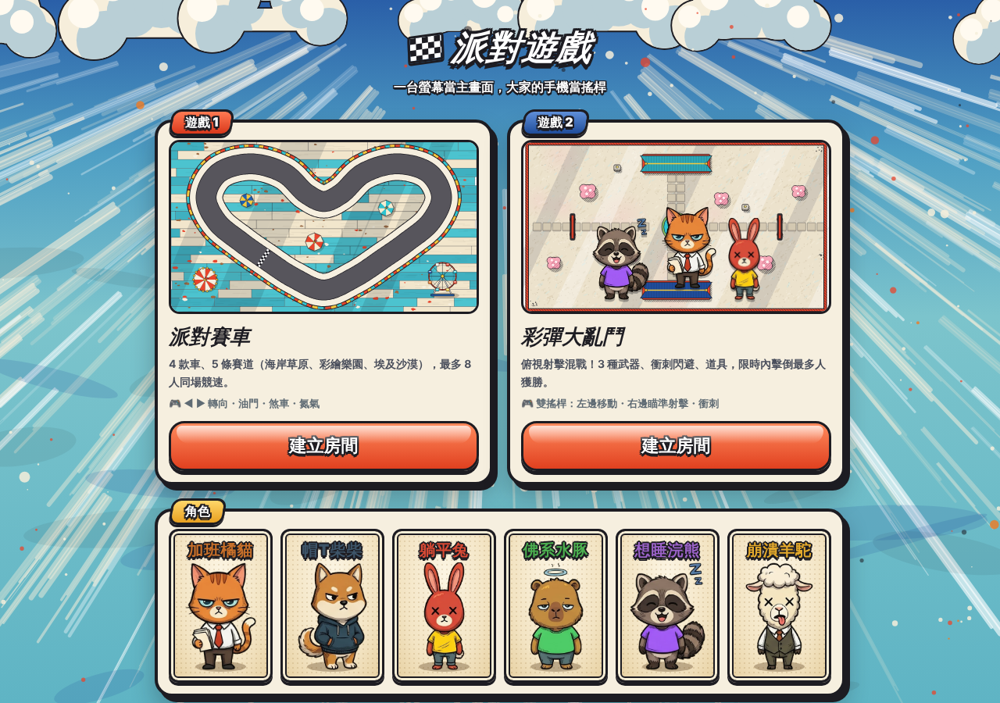

### 視覺風格

**手繪漫畫風**：粗黑墨線、斜線網點陰影、羊皮紙卡片、木頭看板，選單頁的背景是復古海報天空（放射筆刷、卡通積雲）。

- **派對賽車**：深色柏油（碎石顆粒、彎道胎痕、白色虛線）、奶油色路肩、外圈紅白路緣石，草地上一團團墨線灌木，起點是生鏽鋼架的 START 拱門；甩尾會揚起沙塵
- **彩彈大亂鬥**：米色方格磁磚＋斜射光束、手繪紅色中圈，障礙物是木箱、生鏽紅白路障、藍色鐵桶、抽風扇、盆栽、沙發與桌子
- **比賽 HUD**：羊皮紙圈數面板（黃色大字＋計時器）、木頭排行榜（玩家顏色色條＋名次圓章）、木頭房間代碼、紅色結束按鈕
- 玩家的代表色（紅、橙、黃…）維持鮮明：名牌、車身、彩彈、角色腳下的圈圈都用這個顏色，同一個角色也分得出是誰

---

## 怎麼開始

1. **主機**（平板、電腦，或橫放的手機；可以投影到電視）打開遊戲網址，**選一個遊戲**按「建立房間」
2. 畫面出現 **QR code** 和 4 個字的**房間代碼**
3. 朋友用手機相機掃 QR code，在手機上：
   - **角色**分頁：從六位角色選一位（左右滑大卡片或點下面的小卡），輸入名字、選代表色（車身、彩彈、名牌都用這個顏色）
   - **車庫**（賽車）或**武器庫**（大亂鬥）分頁：選車款或武器
   - 按「準備好了！」
4. 主機在「等候室」看到大家（8 個位置），在「比賽設定」選場地、圈數或時間、**電腦玩家數量**（0–7 台），按開始
   - 也可以直接**點等候室的空位**加一台電腦，點電腦卡片上的「電腦 ✕」移除
   - 位置滿了又有朋友加入時，電腦會自動讓位；朋友離開後再補回來
   - 主機的設定會記在這台裝置上，下次開房自動沿用
5. 倒數 3、2、1，手機變成搖桿！比完上頒獎台，可以「再來一場」或「回等候室」

---

## 角色（六位擬人化動物）

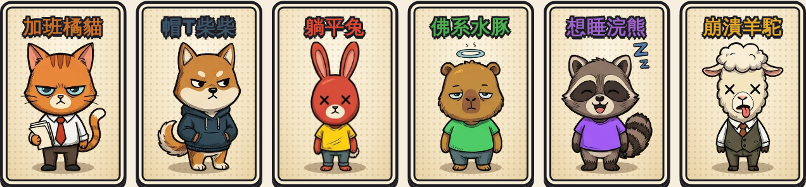

| 角色 | 個性 |
|---|---|
| 加班橘貓 | 被報告追著跑的上班族，臉很臭但很可靠 |
| 帽T柴柴 | 一臉不在乎，其實每件事都看在眼裡 |
| 躺平兔 | 能躺就不坐，咖啡打翻了也沒差 |
| 佛系水豚 | 情緒超穩定，天塌下來也先泡杯咖啡 |
| 想睡浣熊 | 哈欠打到眼淚都出來了，還是想再睡五分鐘 |
| 崩潰羊駝 | 西裝領帶穿好了，人先倒下了 |

| 手機：選角色 | 頒獎台（彩彈大亂鬥） |
|---|---|
| 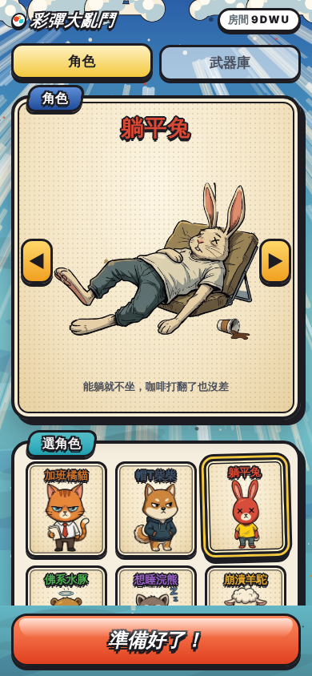 | 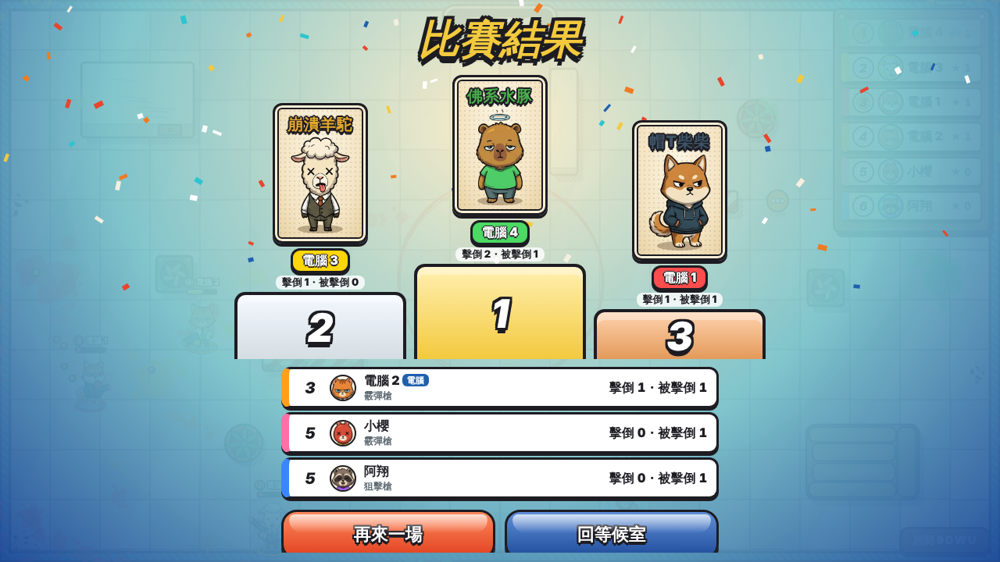 |

- 每位角色有兩種圖：**全身立繪**（手機選角色、等待與結果畫面）和 **Q 版**（遊戲場上的角色、等候室、頒獎台、排名與擊倒訊息的頭像）
- 角色卡是羊皮紙＋雙線框，名字用角色的代表色；賽車時角色的頭像坐在駕駛座上，頒獎時 Q 版站在車子旁邊
- 角色存在手機上，下次開啟自動帶入；電腦玩家會優先挑真人沒選的角色
- 圖檔都是使用者提供的插畫（去背後存成 WebP，放在 `img/chara/`）

---

## 🏁 派對賽車

| 主機：等候室 | 主機：比賽畫面 |
|---|---|
|  |  |

| 手機：車庫 | 手機：搖桿 |
|---|---|
|  | 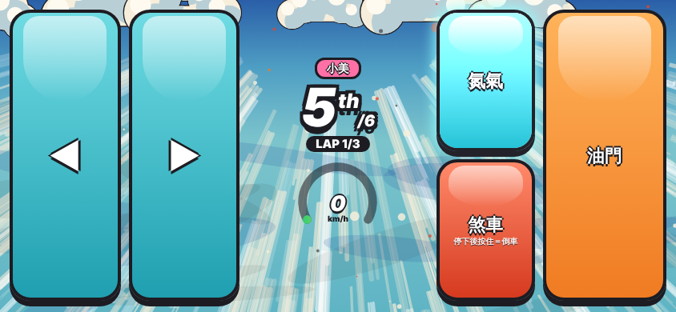 |

| 位置 | 按鈕 | 作用 |
|---|---|---|
| 左邊 | ◀ ▶ | 轉向（手指可以直接左右滑動換邊） |
| 右邊 | 油門 | 加速 |
| 右邊 | 煞車 | 減速；停下後繼續按住 = 倒車 |
| 右邊 | 氮氣 | 按住油門＋氮氣 = 噴射加速，用完會慢慢回充 |

- 手機顯示**名次（1st、2nd…）、圈數、時速表**，氮氣按鈕會顯示存量、集滿會發光；被撞、過圈、抵達終點會震動（Android）
- 逆向會跳警告；開出柏油路會在路肩減速，最外圈是護欄
- 第一名抵達後其他人還有 25 秒；全部真人都到終點就直接結束

### 車款

| 車款 | 類型 | 特色 | 極速 | 加速 | 操控 | 重量 |
|---|---|---|---|---|---|---|
| 彗星 GT | 均衡型 | 各項平均，新手最好上手 | ★★★ | ★★★ | ★★★ | ★★★ |
| 閃電 R | 極速型 | 直線最快，起步慢、過彎容易甩尾 | ★★★★★ | ★★ | ★★ | ★★ |
| 小精靈 | 操控型 | 起步最快、轉彎最靈活，極速較低 | ★★ | ★★★★★ | ★★★★★ | ★ |
| 猛牛 4x4 | 重量型 | 撞人不怕被撞，開上草地也不太減速 | ★★★ | ★★ | ★★ | ★★★★★ |

差距刻意做得不大（電腦實測同賽道單圈約差 5%）：閃電 R 在直線多的賽道最強，小精靈在彎多的賽道最強，猛牛推擠、出界時佔便宜。

### 賽道

| 賽道 | 場景 | 特色 |
|---|---|---|
| 陽光環道 | 海岸草原 | 路寬、彎道平緩，適合新手 |
| 皇冠山道 | 海岸草原 | 兩個髮夾彎，考驗煞車時機 |
| 城市街道 | 海岸草原 | 直角彎加 S 彎，路幅較窄 |
| 歡樂樂園 | 彩繪樂園 | 愛心形賽道；彩繪木地板、摩天輪、旋轉木馬、帳篷、氣球 |
| 金字塔沙漠 | 埃及沙漠 | 長直線高速賽道；金字塔、綠洲、方尖碑、棕櫚樹 |

| 歡樂樂園 | 金字塔沙漠 |
|---|---|
| 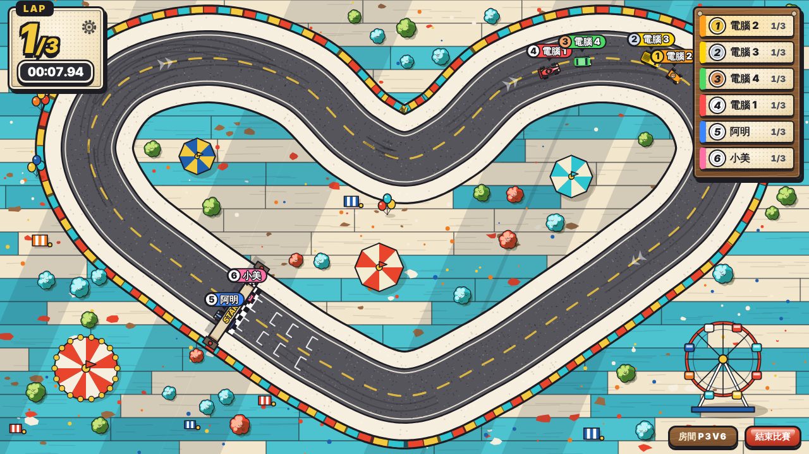 | 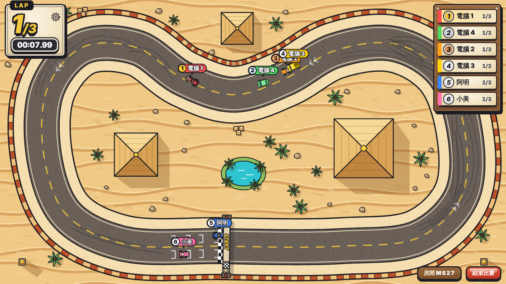 |

場景只改變畫面，不影響操控；大型地標會自動擺在空曠處，不會壓到賽道。

---

## 🎨 彩彈大亂鬥

| 學園頂樓 | 櫻花神社 |
|---|---|
| 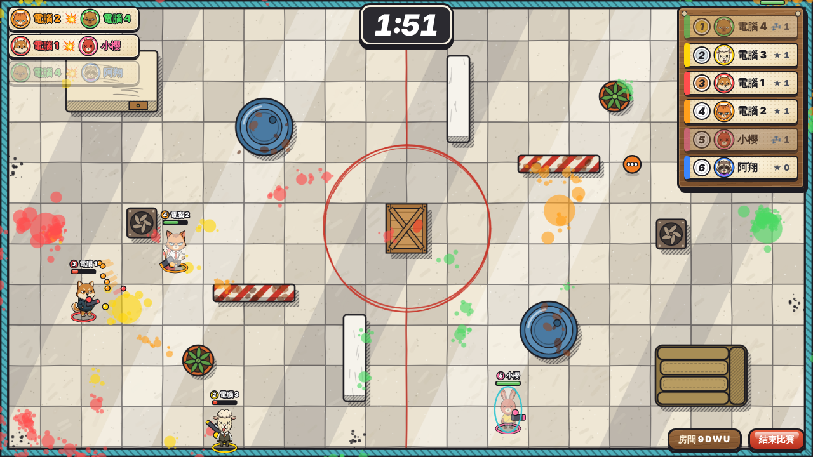 | 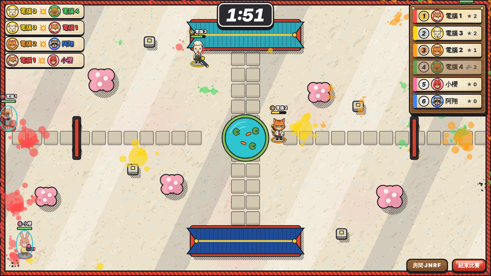 |

| 手機：武器庫 | 手機：雙搖桿 |
|---|---|
| 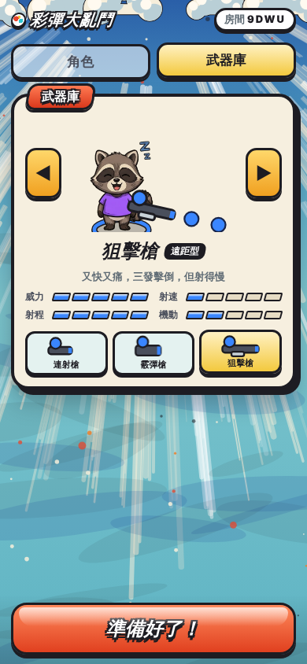 | 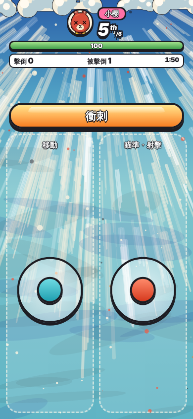 |

**規則**：大家各自為戰，被彩彈打中扣血，血量歸零就被「擊倒」，3 秒後在離對手最遠的地方復活（復活後有短暫無敵）。
時間到時**擊倒數最多**的人獲勝（同分比被擊倒次數少的）。比賽時間可選 1／2／3／5 分鐘。

| 操作 | 作用 |
|---|---|
| 左邊搖桿 | 移動（手指放哪裡，搖桿就出現在哪裡） |
| 右邊搖桿 | 往那個方向瞄準，推著就一直射 |
| 衝刺 | 往移動方向快速衝一小段，衝刺中子彈打不到；有冷卻時間 |

手機上會顯示血量、護盾、擊倒數、名次、剩餘時間；被打中會震動、畫面邊緣閃紅，被擊倒時顯示是誰打倒你和復活倒數。

### 武器

| 武器 | 類型 | 特色 | 威力 | 射速 | 射程 | 機動 |
|---|---|---|---|---|---|---|
| 連射槍 | 連射型 | 射速快、好上手，中距離最穩 | ★★ | ★★★★★ | ★★★ | ★★★★ |
| 霰彈槍 | 近戰型 | 一次噴 5 顆，貼身超痛，衝刺接近是關鍵 | ★★★★★ | ★★ | ★ | ★★★★★ |
| 狙擊槍 | 遠距型 | 又快又痛，三發擊倒，但射得慢 | ★★★★★ | ★ | ★★★★★ | ★★ |

用 8 台電腦打了好幾場 2 分鐘測試，三種武器的「擊倒／被擊倒」比都接近 1，沒有哪把特別強。

### 道具

場上每隔幾秒會冒出道具：**補血**（＋45）、**護盾**（擋 50 點傷害）、**連射加速**、**加速鞋**（各 7 秒）。

### 場地

| 場地 | 特色 |
|---|---|
| 學園頂樓 | 木箱、生鏽路障、藍色鐵桶、抽風扇、盆栽、沙發與桌子，掩護多 |
| 櫻花神社 | 櫻花樹、石燈籠、兩座鳥居，中間是錦鯉水池 |

兩個場地的障礙物都以中心點對稱擺放，每個出生點的位置一樣公平。

---

## 網址

部署到 GitHub Pages 後，遊戲網址是原本網站後面加 `/party-racer/`，例如：

```
https://<你的帳號>.github.io/<repo 名稱>/party-racer/
```

主機開這個網址選遊戲；手機掃 QR code 會自動打開加入頁面（`play.html`），兩個遊戲共用同一個加入頁。

> 這個 repo 的 `.github/workflows/daily.yml` 會把 `party-racer/` 一起部署，
> 改了遊戲檔案推到 main 就會自動重新部署。

---

## 連線原理（為什麼不用架伺服器）

- 手機之間用 **WebRTC 點對點**連線（套件：PeerJS），資料直接在主機和手機之間傳，延遲很低
- 只有「配對」那一下會用到 PeerJS 提供的**免費公用配對伺服器**，配對完就不再經過它
- 建議**大家連同一個 Wi-Fi**，最穩定；用行動網路通常也可以，但少數電信網路可能連不上

### 常見問題

**手機掃了一直顯示「連線中」**
- 確認主機畫面還開著、沒有進入休眠（遊戲會盡量保持螢幕常亮）
- 換成同一個 Wi-Fi 再試
- 公司／學校網路有時會擋 WebRTC，換手機熱點試試

**主機不小心重新整理了**
房間代碼會換一個新的，大家重新掃 QR code 即可。（遊戲會在主機要離開頁面時先跳確認。）

**手機鎖屏或切到別的 App**
回來後會自動重新連線並接回原本的位置；斷線期間你的車／角色會停下來。

**iPhone 不會震動**
iPhone 的 Safari 不開放網頁震動功能，這是系統限制。

**公用配對伺服器掛了怎麼辦**
可以自己架 PeerJS Server，然後在主機網址後面加參數（QR code 會自動帶給手機）：
```
host.html?peerhost=你的伺服器網域&peerport=443&peerpath=/
```

---

## 在自己電腦上測試

```bash
cd party-racer
python3 -m http.server 8080
```

- 開 `http://localhost:8080/index.html?net=local` 選遊戲當主機
- 再開幾個分頁到 QR code 下方的網址當手機（`?net=local` 讓同一台電腦的分頁互連，不需網路）
- 手機分頁也可以用鍵盤：
  - 賽車：方向鍵／WASD 開車，空白鍵氮氣
  - 大亂鬥：WASD 移動、方向鍵瞄準射擊、空白鍵衝刺

想用真的手機測試：電腦和手機連同一個 Wi-Fi，用電腦的區網 IP 開
（例如 `http://192.168.1.23:8080/`），不要加 `net=local`。

### 自動測試

```bash
cd party-racer
npm test             # 邏輯測試：賽道、物理、名次、車款平衡、射擊規則、武器平衡、角色（不需安裝套件）
npm run test:e2e     # 瀏覽器實際操作主機＋手機，把兩個遊戲各走一遍完整流程（需要 Playwright）
```

---

## 想調整遊戲？

- **賽車**：`js/config.js` — 車款 `CARS`、顏色 `COLORS`、賽道 `TRACKS`（控制點＋`theme` 場景）、預設名字 `FUN_NAMES`；
  物理手感在 `js/physics.js` 的 `PHYS`。新增賽道後跑 `npm test` 會自動檢查
- **大亂鬥**：`js/brawl.js` — 基本數值 `BRAWL`（血量、速度、復活時間、衝刺）、武器 `WEAPONS`、道具 `POWERS`、
  場地 `ARENAS`（障礙物以中心點對稱擺放，寫一半就好）
- **角色**：`js/characters.js` 的 `CHARACTERS`（名字、代表色、介紹）；圖檔在 `img/chara/`：`{id}.webp` 全身立繪、`{id}-chibi.webp` Q 版、`{id}-face.webp` 頭像

## 檔案說明

| 檔案 | 作用 |
|---|---|
| `index.html` | 首頁：選遊戲建立房間／輸入代碼加入 |
| `host.html`、`js/host.js` | 派對賽車主機畫面 |
| `brawl.html`、`js/brawl-host.js` | 彩彈大亂鬥主機畫面 |
| `play.html`、`js/controller.js` | 手機：選角色、選車／選武器、賽車搖桿與射擊雙搖桿 |
| `js/room.js` | 兩個遊戲共用的房間：連線、玩家、電腦玩家、等候室、QR code |
| `js/hud.js` | 主機畫面共用的提示、倒數、橫幅、彩帶 |
| `js/backdrop.js` | 所有頁面的海報天空背景（放射筆刷、積雲、油漆噴點） |
| `js/characters.js`、`img/chara/` | 六位角色的資料與圖（立繪、Q 版、頭像） |
| `js/config.js` | 賽車：車款、顏色、賽道 |
| `js/race.js`、`js/physics.js`、`js/track.js`、`js/ai.js` | 賽車：規則、物理、賽道幾何、電腦對手 |
| `js/render.js`、`js/scenery.js` | 賽車：車子與賽道場景的繪圖 |
| `js/brawl.js`、`js/brawl-ai.js`、`js/brawl-render.js` | 大亂鬥：規則、電腦玩家、繪圖 |
| `js/net.js` | 連線 |
| `js/audio.js` | 音效（即時合成，沒有音檔） |
| `vendor/` | 第三方套件：PeerJS 1.5.5（MIT）、qrcode-generator 2.0.4（MIT） |
| `tests/` | 自動測試 |
