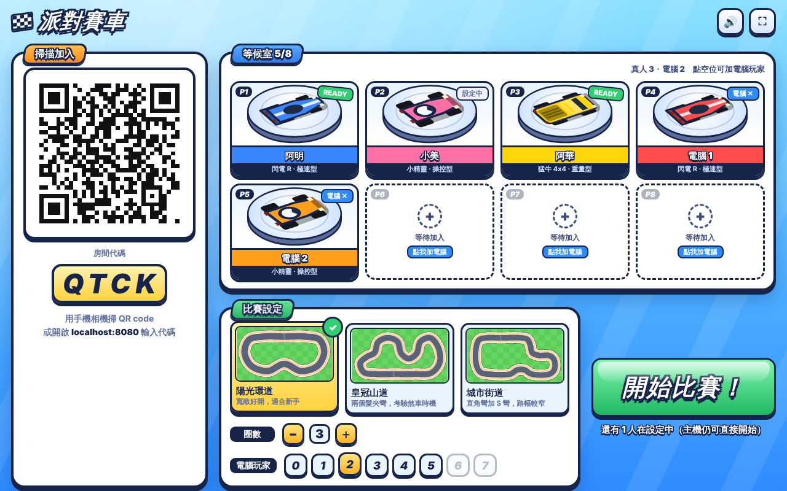
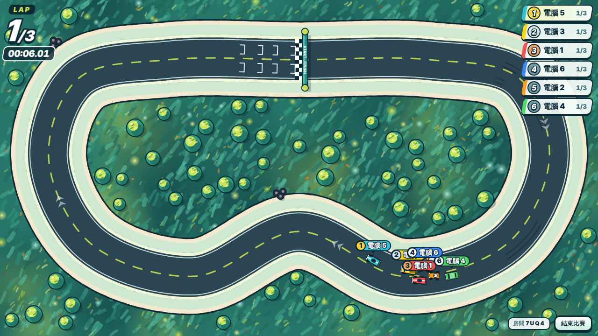
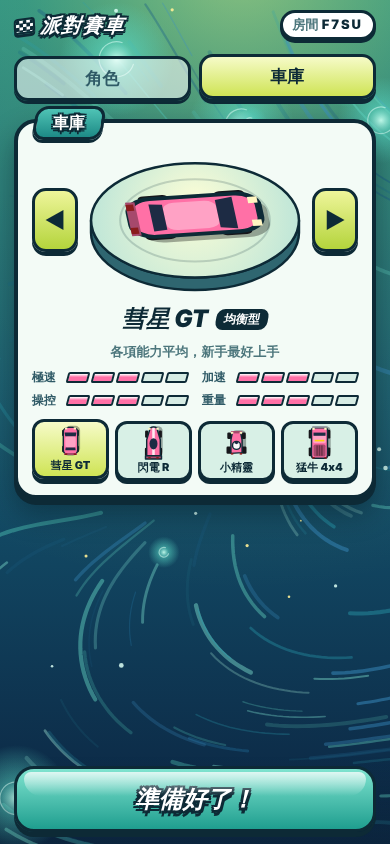
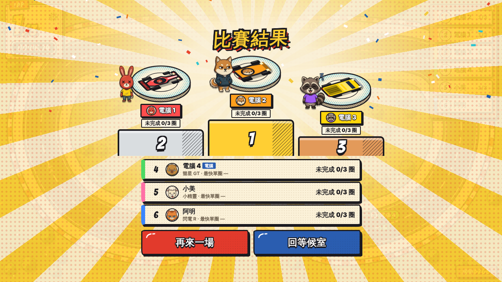

# 🏁 派對賽車 Party Racer

一台裝置當「賽道螢幕」，朋友用手機掃 QR code 就變成搖桿，最多 8 人同場競速。
純網頁、免安裝 App、免架伺服器。

| 主機：等候室（QR code） | 主機：比賽畫面 |
|---|---|
|  |  |

| 手機：車庫（選車／烤漆／名字） | 手機：搖桿（名次、圈數、時速表、氮氣） |
|---|---|
|  |  |

| 主機：頒獎台 |
|---|
|  |

畫面走明亮卡通風：天空藍底、粗描邊面板、按下去會「陷進去」的立體按鈕、
彈跳的倒數數字、最後一圈／FINISH 橫幅、頒獎台加彩帶。

---

## 怎麼玩

1. **主機**（平板、電腦，或橫放的手機；可以投影到電視）打開遊戲網址，按「建立房間」
2. 畫面出現 **QR code** 和 4 個字的**房間代碼**
3. 朋友用手機相機掃 QR code → 進入「車庫」：左右切換車款（也可以直接左右滑）、選烤漆顏色、輸入名字 → 按「準備好了！」
4. 主機在「等候室」看到大家的車停在展示台上（8 個位置），在「比賽設定」選賽道、圈數（1–9 圈）和**電腦玩家數量**（0–7 台），按「開始比賽！」
   - 也可以直接**點等候室的空位**加一台電腦，點電腦卡片上的「電腦 ✕」移除
   - 位置滿了又有朋友加入時，電腦會自動讓位；朋友離開後再補回來
   - 電腦玩家數量、圈數、賽道會記在主機裝置上，下次開房自動沿用
5. 倒數 3、2、1、GO！手機變成搖桿：

| 位置 | 按鈕 | 作用 |
|---|---|---|
| 左邊 | ◀ ▶ | 轉向（手指可以直接左右滑動換邊） |
| 右邊 | 油門 | 加速 |
| 右邊 | 煞車 | 減速；停下後繼續按住 = 倒車 |
| 右邊 | 氮氣 | 按住油門＋氮氣 = 噴射加速，用完會慢慢回充 |

- 手機畫面會顯示你的**名次（1st、2nd…）、圈數、時速表**；氮氣按鈕會顯示存量，集滿時會發光。被撞、過圈、抵達終點會震動（Android）
- 逆向行駛會跳出警告；開出柏油路會在砂石區減速，最外圈是護欄
- 第一名抵達後，其他人還有 25 秒可以完成；全部真人都到終點就直接結束
- 比賽結束上頒獎台，可以「再來一場」（同設定馬上重開）或「回等候室」換車換賽道

## 車款

| 車款 | 類型 | 特色 | 極速 | 加速 | 操控 | 重量 |
|---|---|---|---|---|---|---|
| 彗星 GT | 均衡型 | 各項平均，新手最好上手 | ★★★ | ★★★ | ★★★ | ★★★ |
| 閃電 R | 極速型 | 直線最快，起步慢、過彎容易甩尾 | ★★★★★ | ★★ | ★★ | ★★ |
| 小精靈 | 操控型 | 起步最快、轉彎最靈活，極速較低 | ★★ | ★★★★★ | ★★★★★ | ★ |
| 猛牛 4x4 | 重量型 | 撞人不怕被撞，開上草地也不太減速 | ★★★ | ★★ | ★★ | ★★★★★ |

差距刻意做得不大（用電腦對手實測，同一條賽道上各車款單圈差距約 5%），
**閃電 R 在大直線多的「陽光環道」最強，小精靈在彎多的「皇冠山道」「城市街道」最強**，
猛牛則是在推擠、出界時佔便宜。

## 賽道

| 賽道 | 特色 |
|---|---|
| 陽光環道 | 路寬、彎道平緩，適合新手 |
| 皇冠山道 | 兩個髮夾彎，考驗煞車時機 |
| 城市街道 | 直角彎加 S 彎，路幅較窄 |

---

## 網址

部署到 GitHub Pages 後，遊戲網址是原本網站後面加 `/party-racer/`，例如：

```
https://<你的帳號>.github.io/<repo 名稱>/party-racer/
```

主機開這個網址按「建立房間」即可，手機掃 QR code 會自動打開加入頁面（`play.html`）。

> 這個 repo 的 `.github/workflows/daily.yml` 已經會把 `party-racer/` 一起部署，
> 改了遊戲檔案推到 main 就會自動重新部署。

---

## 連線原理（為什麼不用架伺服器）

- 手機之間用 **WebRTC 點對點**連線（套件：PeerJS），資料直接在主機和手機之間傳，延遲很低
- 只有「配對」那一下會用到 PeerJS 提供的**免費公用配對伺服器**，配對完就不再經過它
- 建議**大家連同一個 Wi-Fi**，最穩定；用行動網路通常也可以，但少數電信網路可能連不上

### 常見問題

**手機掃了一直顯示「連線中」**
- 確認主機畫面還開著、沒有進入休眠（遊戲會盡量保持螢幕常亮）
- 換成同一個 Wi-Fi 再試
- 公司／學校網路有時會擋 WebRTC，換手機熱點試試

**主機不小心重新整理了**
房間代碼會換一個新的，大家重新掃 QR code 即可。（遊戲會在主機要離開頁面時先跳確認。）

**手機鎖屏或切到別的 App**
回來後會自動重新連線並接回原本的車；斷線期間你的車會停下來。

**iPhone 不會震動**
iPhone 的 Safari 不開放網頁震動功能，這是系統限制。

**公用配對伺服器掛了怎麼辦**
可以自己架 PeerJS Server，然後在主機網址後面加參數（QR code 會自動帶給手機）：
```
host.html?peerhost=你的伺服器網域&peerport=443&peerpath=/
```

---

## 在自己電腦上測試

```bash
cd party-racer
python3 -m http.server 8080
```

- 開 `http://localhost:8080/host.html?net=local` 當主機
- 再開幾個分頁到 QR code 下方的網址當手機（`?net=local` 讓同一台電腦的分頁互連，不需網路）
- 手機分頁也可以用鍵盤：方向鍵／WASD 開車，空白鍵氮氣

想用真的手機測試：電腦和手機連同一個 Wi-Fi，用電腦的區網 IP 開
（例如 `http://192.168.1.23:8080/host.html`），不要加 `net=local`。

### 自動測試

```bash
cd party-racer
npm test                         # 賽道、物理、名次、車款平衡等邏輯測試（不需安裝套件）
node tests/e2e.browser.cjs       # 瀏覽器實際操作主機＋兩支手機走完整流程（需要 Playwright）
```

---

## 想調整遊戲？

幾乎所有數值都在 **`js/config.js`**：

- **車款**：`CARS` — 極速、加速、轉向、抓地力、重量、出界保留速度，加一筆就多一台車
  （造型目前有 `coupe`、`sport`、`kart`、`truck` 四種，畫法在 `js/render.js`）
- **顏色**：`COLORS`
- **賽道**：`TRACKS` — 一串控制點（畫面座標 1600×900）會自動連成平滑賽道。
  新增賽道後跑 `npm test`，會檢查路段有沒有靠太近、有沒有超出畫面
- **預設名字**：`FUN_NAMES`

物理手感（煞車力道、氮氣時間等）在 `js/physics.js` 開頭的 `PHYS`。

## 檔案說明

| 檔案 | 作用 |
|---|---|
| `index.html` | 首頁：建立房間／輸入代碼加入 |
| `host.html`、`js/host.js` | 主機畫面：QR code、大廳、比賽畫面、結果 |
| `play.html`、`js/controller.js` | 手機搖桿：設定名稱顏色車款、比賽操作 |
| `js/config.js` | 車款、顏色、賽道設定 |
| `js/race.js` | 比賽規則：倒數、圈數、名次、終點 |
| `js/physics.js` | 車子物理 |
| `js/track.js` | 賽道幾何 |
| `js/ai.js` | 電腦對手 |
| `js/render.js` | 車子與賽道的繪圖 |
| `js/net.js` | 連線 |
| `js/audio.js` | 音效（即時合成，沒有音檔） |
| `vendor/` | 第三方套件：PeerJS 1.5.5（MIT）、qrcode-generator 2.0.4（MIT） |
| `tests/` | 自動測試 |
